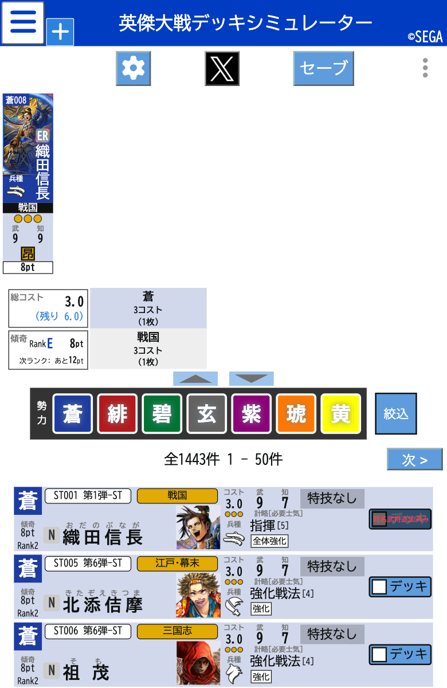
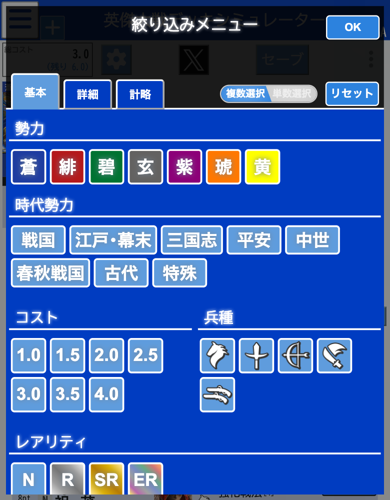

# このツールについて

アーケードゲーム（ゲームセンター用ゲーム） [英傑大戦](https://www.eiketsu-taisen.com/) のデッキシミュレーターです。

## 注意

- 本ツールは個人が作成した非公式のツールです。
- 利用している画像やデータの著作権は[株式会社セガ](https://www.sega.co.jp/)にあります。
- 本ツールに関するお問い合わせを、英傑大戦の運営元である株式会社セガへ行うことは絶対にやめてください。
- 以上のことを理解した上で自己責任のもとでお使いください。

## 使い方

1. 「絞込」で勢力やコストなどを選び、一覧から目当ての武将を探す
2. 見つけたら「デッキ」にチェックを入れる
3. 1〜2 を繰り返してデッキを完成させる

デッキ編成

{: width="300"}

絞り込み

{: width="300"}

作ったデッキは、ブラウザのアドレス欄のURLをコピーして送るだけで、相手にもそのまま見せられます。

<small>※画像内のカードイラスト・データ &copy;SEGA</small>

## その他

### 動作対象ブラウザ

下記のブラウザで動作しますが、ブラウザやOSのバージョンが古いと正しく動作しない場合があるため、なるべく最新のバージョンをお使いください。

- Google Chrome
- Safari (Mac)
- Safari (iOS)
- Android Chrome

### 使用しているライブラリについて

[こちら](licenses.md) をご確認ください。

### Google Analytics について

本ツールは機能改善の参考にするため、Google Analytics を使用して機能の使用状況や使用されているブラウザ・OSなどの情報を取得しています。
Google Analytics はその解析のために Web ブラウザの Cookie を使用しています。
収集するデータは匿名のもので個人を特定するものではありません。
詳しくは[こちら](https://policies.google.com/technologies/partner-sites?hl=ja)をご確認ください。
